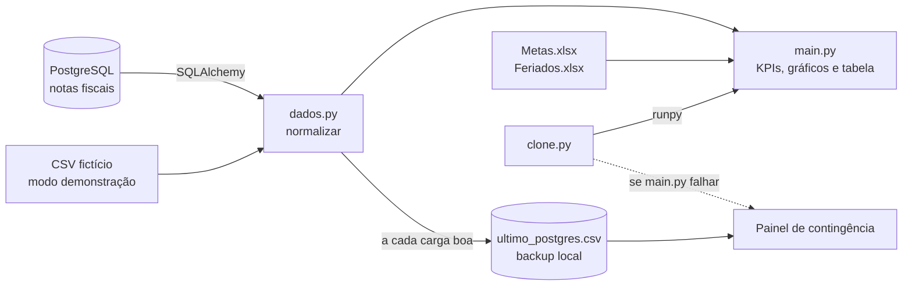

<div align="center">

# 🏭 Painel de Expedição de Cimento

**Dashboard em Streamlit para acompanhar a saída de cimento das fábricas, comparar o volume expedido com a meta do mês e mostrar se a operação está à frente ou atrás do ritmo necessário.**


</div>

> [!IMPORTANT]
> **Este repositório usa apenas dados fictícios.** O painel foi desenvolvido para uso interno em uma indústria cimenteira, e a versão publicada aqui roda em **modo demonstração**: lê uma base inventada (`dados_locais/dados_expedicao_ficticios.csv`) em vez do banco da empresa. Clientes, placas, notas fiscais, volumes e metas não correspondem a nenhuma informação real. Nenhuma credencial está no código — o acesso ao banco e ao SMTP vem de `st.secrets`, que fica fora do Git.

<br>


## Sumário

- [O que o painel mostra](#o-que-o-painel-mostra)
- [Como rodar](#como-rodar)
- [Arquitetura](#arquitetura)
- [Regras de negócio](#regras-de-negócio)
- [Alta disponibilidade (modo contingência)](#alta-disponibilidade-modo-contingência)
- [Alertas e logs](#alertas-e-logs)
- [Planilhas de apoio](#planilhas-de-apoio)
- [Configuração para produção](#configuração-para-produção)
- [A base fictícia](#a-base-fictícia)
- [Próximos passos](#próximos-passos)

---

## O que o painel mostra

O painel tem uma tela **consolidada** (todas as unidades somadas) e uma tela para cada fábrica — **Itabira, Itapetinga, Itapicuru e Cibrasa**. Na barra lateral o usuário escolhe os meses de competência (o mês atual vem marcado) e a unidade.

**Indicadores (cards)**

| Card | O que significa |
| :--- | :--- |
| **Meta consolidada** | Soma das metas, em sacos de 50 kg, dos meses selecionados, com o total de dias úteis do período. |
| **Expedido** | Volume que já saiu, em sacos de 50 kg, e o percentual da meta. |
| **Ritmo esperado** | Quanto já deveria ter saído até hoje para fechar a meta no prazo, e quantos sacos a operação está à frente ou atrás desse ritmo. |
| **Falta expedir** | Meta menos o expedido. |
| **Média diária necessária** | O que falta dividido pelos dias úteis restantes. |

Logo abaixo, uma **barra de progresso da meta** com degradê (vermelho → amarelo → verde) e um marcador mostrando onde o volume deveria estar hoje.

**Gráficos (Altair)**

- **Meta vs Realizado** — linhas mês a mês, com filtro por unidade e por período (só na tela consolidada).
- **Resumo de evolução física** — barras mensais com o traço da meta e a diferença em sacos (+ acima / − abaixo) nos meses fechados; o mês corrente aparece como parcial.
- **Top 5 clientes** — ranking por volume, com a participação de cada um no período.

**Tabela detalhada** com filtros por período, cliente, produto e placa, e botão para **baixar o recorte em CSV**.

<p align="center">
  
</p>

---

## Como rodar

```bash
git clone https://github.com/gabriel-buarque/painel-expedicao.git
cd painel-expedicao

python -m venv .venv
source .venv/bin/activate        # Windows: .venv\Scripts\activate
pip install -r requirements.txt

streamlit run main.py
```

O painel abre em `http://localhost:8501` já com a base fictícia, sem precisar de banco de dados nem de `secrets.toml`.

| Comando | Quando usar | Comportamento |
| :--- | :--- | :--- |
| `streamlit run main.py` | Desenvolvimento | Roda o painel direto. Um erro aparece na tela, com o traceback do Streamlit. |
| `streamlit run clone.py` | Produção | Roda o mesmo painel protegido pelo modo contingência: se algo falhar, o usuário vê os dados do último backup em vez de uma tela de erro. |

---

## Arquitetura

```
painel-expedicao/
├── main.py              # Painel principal: KPIs, barra da meta, gráficos e tabela
├── clone.py             # Ponto de entrada de produção + painel de contingência autossuficiente
├── dados.py             # Consulta ao PostgreSQL, normalização, backup em CSV e leitura das metas
├── graficos.py          # Os três gráficos em Altair
├── interface.py         # Barra lateral: meses, unidades e botão "Atualizar dados"
├── alertas.py           # Log em arquivo e alerta por e-mail (SMTP SSL)
├── caminhos.py          # Caminhos do projeto com pathlib (cria as pastas se faltarem)
├── .streamlit/
│   └── config.toml      # Tema (laranja #E96107, fundo claro)
├── assets/              # Logos usados no cabeçalho e na barra lateral
└── dados_locais/
    ├── dados_expedicao_ficticios.csv   # Base fictícia (12.000 notas)
    └── Metas.xlsx                      # Metas fictícias por unidade e mês
```



### Fonte de dados

Em `dados.py`, a chave `MODO_TESTE = True` faz o painel ler o CSV fictício. Com `MODO_TESTE = False`, ele consulta o PostgreSQL (SQLAlchemy + psycopg2, com `pool_pre_ping` e reciclagem da conexão a cada 30 min).

A consulta já traz só o que conta como expedição:

- famílias de cimento **CP I a CP V**;
- notas com status **"Uso autorizado"** e sem data de cancelamento;
- sem devolução registrada;
- excluindo CFOPs de transferência, remessa, retorno e devolução;
- notas fiscais complementares entram com quantidade zero, para não contar o mesmo volume duas vezes;
- emitidas a partir de 01/01/2026.

O código da empresa vindo do ERP (1, 3, 4, 5) é traduzido para o nome da fábrica.

### Cache

| Função | Tipo | Validade |
| :--- | :--- | :--- |
| `conectar_postgres()` | `st.cache_resource` | Toda a vida do servidor (uma conexão compartilhada) |
| `carregar_fonte()` / `carregar_dados_sistema()` | `st.cache_data` | 10 min |
| `carregar_planilha_metas()` / `carregar_feriados()` | `st.cache_data` | 1 h |

O botão **Atualizar dados** limpa só o `cache_data` — a conexão com o banco continua aberta — e volta os filtros ao padrão.

---

## Regras de negócio

### Normalização (`dados.py → normalizar`)

Toda fonte passa pelo mesmo funil e sai com as mesmas 8 colunas: `Fábrica`, `Data`, `Cliente`, `Placa`, `Quantidade (Sacos)`, `Item`, `Mês_Num`, `Dia_Mes`.

- Textos em caixa alta e sem espaços nas pontas.
- Quantidades em texto são convertidas com cuidado: só é tratado como formato brasileiro (`1.234,50`) quando existe vírgula; sem vírgula, o ponto é decimal — evita transformar `1250.5` em `12505`.
- Linhas sem data válida são descartadas.
- Se faltar alguma coluna, o erro aparece na carga, e não depois como um KPI errado.
- **Anti-duplicidade:** a mesma nota (fonte + fábrica + número) entra uma única vez.

### Dias úteis e ritmo

O cálculo de dias trabalhados replica a medida DAX que a empresa já usava no Power BI:

- segunda a sexta valem **1 dia**, sábado vale **0,5** e domingo **0**;
- no mês atual, conta do dia 1º até **ontem**, descontando os feriados da `Feriados.xlsx`;
- meses passados usam os dias úteis da planilha de metas; meses futuros contam 0.

Com isso:

```
ritmo esperado          = meta × (dias já trabalhados ÷ dias úteis do período)
diferença para o ritmo  = expedido − ritmo esperado
média diária necessária = (meta − expedido) ÷ dias úteis restantes
```

---

## Alta disponibilidade (modo contingência)

Em produção o servidor roda `clone.py`, que executa o `main.py` com `runpy` dentro de um `try`:

1. **Caminho normal:** o `main.py` roda e carrega os dados do banco. A cada carga bem-sucedida o `dados.py` salva um backup em `dados_locais/ultimo_postgres.csv` (grava num `.tmp` e substitui, para nunca deixar um arquivo pela metade). Uma consulta que volta vazia não sobrescreve o backup bom.
2. **Se uma fonte cair**, o próprio `dados.py` usa o backup daquela fonte e o painel segue normalmente.
3. **Se o `main.py` inteiro quebrar**, o `clone.py` registra o erro, envia o alerta e marca a sessão como em contingência por **10 minutos**. Nesse período o usuário vê o **painel de contingência**: a mesma tela, os mesmos KPIs e gráficos, alimentados pelo último backup.
4. Depois dos 10 minutos — ou ao clicar em **Atualizar dados** — o painel tenta o `main.py` de novo.

Detalhes que fazem isso funcionar:

- O clone é **autossuficiente**: não importa `dados.py`, `interface.py`, `graficos.py` nem `alertas.py` (só `caminhos.py`). Se um desses arquivos tiver um erro, o clone continua de pé. Ele tem o próprio log e o próprio envio de e-mail.
- `st.stop()` e `st.rerun()` funcionam lançando exceções internas do Streamlit. O clone reconhece essas exceções e as deixa passar — sem isso, desmarcar todos os meses ou clicar em "Atualizar" colocaria o painel em contingência sem nenhuma falha real.

---

## Alertas e logs

`alertas.py → notificar_admin(titulo, erro)`:

- grava sempre o traceback em `logs/app_errors.log`;
- em **desenvolvimento**, imprime no terminal e para por aí;
- em **produção** (`ambiente.modo = "producao"` nos secrets), envia um e-mail via **SMTP SSL** (porta 465 por padrão, timeout de 15 s);
- **anti-inundação:** o mesmo alerta é enviado no máximo uma vez a cada 15 minutos — banco fora do ar não vira um e-mail por clique de cada usuário.

Os alertas nunca usam `st.toast`, porque são chamados de dentro de funções com `@st.cache_data` e o Streamlit quebraria ao reproduzir o cache.

---

## Planilhas de apoio

### `dados_locais/Metas.xlsx` (obrigatória)

| Coluna | Uso |
| :--- | :--- |
| `Unidade` | Nome da fábrica, igual ao usado no painel (ex.: `ITABIRA`) |
| `Mês` | Número do mês (1 a 12) |
| `Vendas` | Meta do mês em sacos de 50 kg |
| `Dias` | Dias úteis do mês (se a coluna não existir, usa 22) |

As colunas `Ano`, `Ano-Mês` e `CodCorporacao` podem existir, mas não são lidas. Se a planilha faltar, o painel funciona com metas zeradas e mostra um aviso. Alterações levam até 1 hora para aparecer (ou na hora, clicando em **Atualizar dados**).

### `dados_locais/Feriados.xlsx` (opcional)

| Coluna | Uso |
| :--- | :--- |
| `Corporação` | Fábrica do feriado |
| `DATA FERIADO` | Data (dia/mês/ano) |
| `FERIADO` | Quanto descontar dos dias trabalhados (ex.: 1 ou 0,5) |

Sem essa planilha, o cálculo considera que não há feriados.

---

## Configuração para produção

1. Em `dados.py`, troque para `MODO_TESTE = False`.
2. Crie `.streamlit/secrets.toml` (não versionar):

```toml
[ambiente]
modo = "producao"          # qualquer outro valor = desenvolvimento (sem e-mail)

[postgres]
host = "..."
port = 5432
database = "..."
user = "..."
password = "..."

[alertas]
smtp_host = "smtp.seudominio.com"
smtp_port = 465
smtp_user = "..."
smtp_password = "..."
remetente = "painel@seudominio.com"
destinatario = "equipe@seudominio.com"
```

3. Suba com `streamlit run clone.py`.

---

## A base fictícia

`dados_locais/dados_expedicao_ficticios.csv` foi gerada só para este repositório:

- **12.000** notas fiscais de janeiro a dezembro de 2026;
- 4 fábricas, com volumes distribuídos de forma parecida entre elas;
- **130 clientes** com nomes genéricos (`CLIENTE 8`, `CONSTRUTORA 34`, `DEPÓSITO 12`…);
- placas, números de nota (`NF-000001`…) e quantidades (250 a 1.499 sacos por carga) aleatórios;
- tipos de cimento CP I a CP V.

As metas da `Metas.xlsx` também são fictícias (entre 160 mil e 219 mil sacos por unidade/mês).

---

## Próximos passos

- [ ] Gerar o backup também no modo demonstração, para dar para testar o modo contingência só com a base fictícia.
- [ ] Remover `mysql-connector-python` do `requirements.txt` (sobra da versão em MariaDB) e fixar as versões das dependências.
- [ ] Reaproveitar o CSS e as funções de gráfico entre `main.py` e `clone.py` sem quebrar o isolamento do clone.
- [ ] Testes automatizados para `normalizar()` e para o cálculo de dias trabalhados.

---

<div align="center">

Desenvolvido por **[Gabriel Buarque](https://github.com/gabriel-buarque)**

</div>
